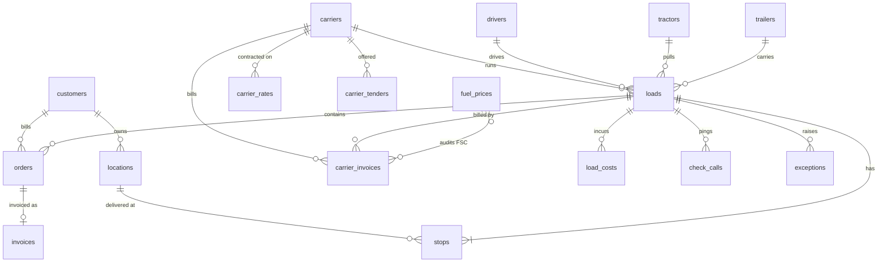

# Data Model: TMS Intelligence

The source of truth is `tms_agent/schema.py` (column-level descriptions are used for NL-to-SQL grounding).
Generated DDL: `sql/bigquery_schema.sql`, `sql/alloydb_schema.sql`.

| Table | Grain | Key columns |
|---|---|---|
| customers | chain | customer_id, segment, service_tier, on_time_target_pct, late_penalty_per_stop |
| locations | DC / store / restaurant | location_id, location_type, customer_id, dc_id, state, dock hours, padd_region |
| carriers | carrier | carrier_id (MCLN = private fleet), carrier_type, equipment_types, safety_rating |
| drivers / tractors / trailers | asset | HOS hours, mpg, PM due, reefer_unit_age_years |
| orders | delivery order | order_id, customer_id, load_id, commodity, cases, revenue split |
| loads | trip (legheader) | load_id, origin_dc_id, carrier_id, driver_id, equipment_type, load_date, miles, status, revenue, cost |
| stops | stop | stop_id, load_id, appointment window, arrival, on_time_flag, minutes_late, detention_minutes, shorts |
| load_costs | cost line | cost_type (DRIVER_PAY, FUEL, CARRIER_LINEHAUL, DETENTION_PAID, LUMPER...), amount |
| invoices | customer invoice | detention_billed, late_penalty_amount, total |
| carrier_rates | contract line | carrier x origin DC x dest state x equipment: rate_per_mile, stop_charge, min_charge, FSC base / mpg, detention terms |
| carrier_invoices | freight bill | billed rate, miles, linehaul, FSC (nullable), detention, lumper + receipt, source, document_uri |
| carrier_tenders | tender | response ACCEPTED / REJECTED / EXPIRED, response_minutes |
| check_calls | telematics ping | reefer temp vs setpoint, ETA to next stop |
| exceptions | event | exception_type, severity, root_cause, resolved_flag, cost_impact |
| fuel_prices | week x PADD | diesel_price_per_gal |
| agent_decision_log | decision | decision_type, status, confidence, amount_usd, rationale, data_used (JSON) |

Views: `v_load_profitability` (completed loads with margin and cost/mile), `v_stop_service` (arrived stops
with customer context), `v_carrier_scorecard`.
